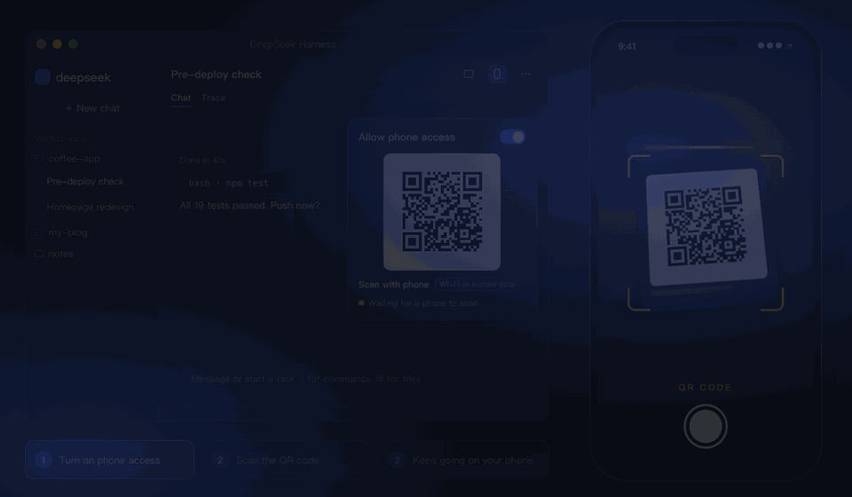
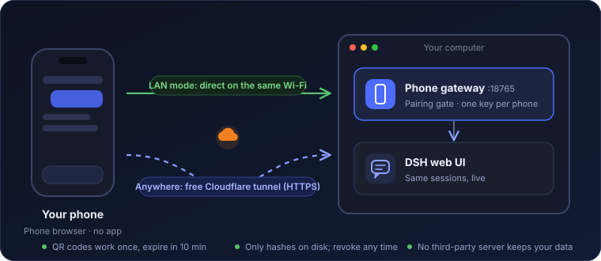

<div align="center">


<p>
  <a href="https://github.com/OrderG-X/dsh-mobile/releases"></a>
  
  <a href="https://github.com/awesome-dsh-plugin/awesome-dsh-plugin"></a>
  
  
</p>

<p>
  <a href="README.md">简体中文</a> ·
  <a href="README.en.md"><b>English</b></a>
</p>

**DSH is running a task on your computer and you have to leave? Scan once and keep watching and replying from your phone.**

</div>

<p align="center">
  
</p>
<p align="center"><sub>Animated demo with sample data.</sub></p>

## Why

| | |
|---|---|
| 📱 **Scan and go** | No app, no account. Point the phone camera at the QR code and the phone browser opens the same DSH as your computer. |
| 🔄 **Same sessions, live** | A message sent from the phone shows up on the computer at once; you see the model's progress on the phone as it happens. |
| 🌍 **Works anywhere** | Goes through a free Cloudflare tunnel (HTTPS): the same link at home or on mobile data outside. Set up automatically when you flip the switch. |
| 🔐 **Only your paired phones** | Each QR code works once and expires in 10 minutes; every phone gets its own credential, which you can revoke at any time. |

## Install

```sh
dsh plugin add https://github.com/OrderG-X/dsh-mobile/releases/latest/download/dsh-mobile.tgz
```

**Restart DSH** afterwards. It shows up as "Mobile" on the DSH Plugins page.

## Use

1. **On the computer**: click the phone button in the session header (or DSH → Plugins → Mobile) and turn on "Allow phone access".
2. **On the phone**: scan the QR code with the camera. It works at home and on the go.
3. **Later**: just open the same address on the phone (add it to the home screen). It survives DSH restarts, so no rescan.

While a phone is connected, the phone button in the header shows a green dot. If you cannot scan, use "Copy link" and open it on the phone (works once, within 10 minutes).

> The first time outside access is turned on, Cloudflare's official cloudflared (about 20 MB) is downloaded automatically, which takes about half a minute. Meanwhile a temporary code is shown and swapped when the tunnel is ready.

## How it works

<p align="center"></p>

The plugin runs a small gateway inside DSH (port 18765 by default) and forwards the phone's requests to DSH's own web UI on the computer. The phone runs the official DSH web UI, so sessions and settings are exactly what you have on the computer.

<details>
<summary><b>Technical details</b></summary>

- DSH desktop's web UI requires a login. Inside the DSH process the gateway trades the launch token for a session cookie and attaches it for the phone; that cookie never reaches the phone.
- The phone's own credential is issued by the gateway (HttpOnly, SameSite=Strict). Only its hash is stored on disk. A credential only works on the path it was paired on: one paired over Wi-Fi (plain HTTP) is refused on the outside tunnel.
- The Mobile settings (switch, QR code, paired phones) can only be managed in DSH on the computer; a phone cannot read the pairing code.
- The local network is plain HTTP, which lacks some "secure context" browser APIs; the gateway adds the one DSH needs.
- When a live connection is idle, the gateway sends keepalive pings toward the phone so tunnels and carriers don't drop it.
- Outside access uses `cloudflared tunnel --url` (a trycloudflare.com quick tunnel): Cloudflare forwards HTTPS traffic to the gateway on your computer, and the gateway's pairing still guards the door.
- To keep the address, the tunnel keeps running in the background when DSH quits (it uses almost nothing) and is picked up again next time; turning off phone access stops it.

</details>

## Security

A paired phone can make DSH work on this computer, just like sitting at it. So:

| Situation | What to do |
|---|---|
| QR codes | Scan only with your own phone; never send the code to anyone or post a screenshot |
| Lost phone | Remove it under "Paired phones"; it is disconnected at once |
| Public Wi-Fi | Same-Wi-Fi mode is plain HTTP; use the outside code (HTTPS) instead |
| Not using it | Turn off "Allow phone access"; the gateway stops listening |

Data lives in `~/.dsh/dsh-mobile/`: `state.json` (switches), `devices.json` (paired phones, 0600), `mobile.log`, `tunnel.json` and `cloudflared.log` (outside tunnel), and `bin/cloudflared` if downloaded.

## FAQ

<details>
<summary><b>Do I need to install an app?</b></summary>

No. Scan with the phone camera and it opens in the phone browser.

</details>

<details>
<summary><b>Do I have to scan again after a restart?</b></summary>

Not after restarting DSH. After the computer restarts, phone access is turned off, or the plugin is disabled or uninstalled in DSH, the outside address changes and you scan once more.

</details>

<details>
<summary><b>Is it fast enough on mobile data in mainland China?</b></summary>

Yes for everyday use. Cloudflare's free network has no points of presence in mainland China, so requests travel abroad and back: the first load takes a second or two, after that watching tasks and sending messages feels fine. A weak signal makes it noticeably slower.

</details>

<details>
<summary><b>What if someone else gets my QR code?</b></summary>

A code works once and expires in 10 minutes, so a code you already scanned is useless. If someone did scan it first, the phone shows up under "Paired phones"; remove it.

</details>

<details>
<summary><b>Does it work while the computer sleeps?</b></summary>

No. Nothing works while the computer sleeps or DSH is closed.

</details>

## Limitations

- The phone shows DSH's web UI as is; there is no phone-specific layout.
- Outside access uses Cloudflare's free quick tunnels, which have no uptime guarantee.
- Tested with DSH desktop on macOS only; the cloudflared download paths for Windows and Linux are written but untested.

## Development

```sh
npm test   # script tests for the gateway, pairing, live connections and keepalive
```

## License

MIT
