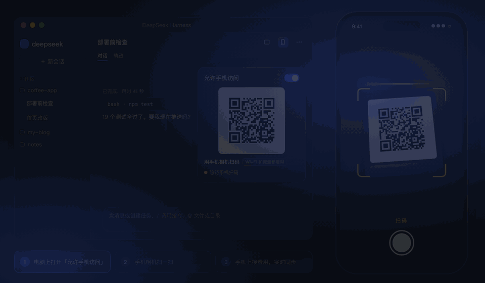
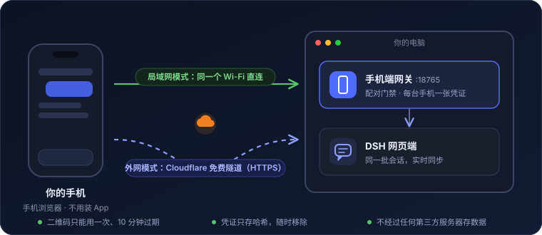

<div align="center">



<p>
  <a href="https://github.com/OrderG-X/dsh-mobile/releases"></a>
  
  <a href="https://github.com/awesome-dsh-plugin/awesome-dsh-plugin"></a>
  
  
</p>

<p>
  <a href="README.md"><b>简体中文</b></a> ·
  <a href="README.en.md">English</a>
</p>

**电脑上的 DSH 跑着任务，人出门了？手机扫一下，接着看、接着发消息。**

</div>

> **一句话**：DeepSeek Harness（DSH）插件，在手机浏览器里用电脑上的 DSH：扫码后看任务进度、回消息、点批准。走免费的 Cloudflare 隧道，在外面用流量也能连，不用装 App。
>
> **什么时候用**：「出门了想在手机上看任务」「人不在电脑前也想回消息、点批准」。
>
> **安装**：`dsh plugin add @orderg-x/dsh-mobile`（npm 包），重启 DSH。目前只在 macOS 上测过。

<p align="center">
  
</p>
<p align="center"><sub>演示动画，内容是示例数据。</sub></p>

## 有什么好

| | |
|---|---|
| 📱 **扫一下就能用** | 不用装 App、不用注册账号。手机相机扫码，手机浏览器里就是电脑上那个 DSH。 |
| 🔄 **同一批会话，实时同步** | 手机上发的消息，电脑上同时出现；模型干到哪，手机上实时看得到。 |
| 🌍 **在哪都能连** | 走 Cloudflare 免费隧道（HTTPS），在家在外都是同一个地址，出门用流量也能连。打开开关就自动准备好。 |
| 🔔 **跑完、要批准时推到手机** | 填一个 Bark / ntfy / Server酱 / 群机器人地址，任务跑完或等你点批准时手机响一下，点通知直接打开。 |
| 🔐 **只认你配过的手机** | 二维码只能用一次、10 分钟过期；每台手机一张凭证，随时移除，移除立刻断开。 |

## 安装

```sh
dsh plugin add @orderg-x/dsh-mobile
```

也可以直接装发布包：`dsh plugin add https://github.com/OrderG-X/dsh-mobile/releases/latest/download/dsh-mobile.tgz`。装完**重启 DSH**。DSH「插件」页里显示为「手机端」。

> **从 0.2.x 升级**：0.3.0 起包名改成 `@orderg-x/dsh-mobile`（npm 上的 `dsh-mobile` 是别人的包）。装上新版后，到「插件」页把旧的「dsh-mobile」移除，再重启 DSH。旧版还在时新版不会启动，只提示你移除旧版。设置都会保留；外网地址会换一个，手机重扫一次就好。

## 怎么用

1. **电脑上**：点会话顶栏的手机按钮（或 DSH →「插件」→「手机端」），打开「允许手机访问」。
2. **手机上**：用相机扫出现的二维码，在家在外都能用。
3. **以后**：直接在手机上打开那个地址就行，建议「添加到主屏幕」（见常见问题）。DSH 重启后地址不变，不用重扫。
4. **想让手机响**：填一个推送地址，见下面的「手机推送」。

手机连着时，顶栏的手机按钮会亮绿点。扫不了码就点「复制链接」，发到手机上打开（10 分钟内有效、只能用一次）。

## 手机推送（可选）

不想一直盯着手机？在「手机端」页的「推送到手机」里填一个地址，DSH 会在这两种时候推一条：

- **任务跑完**（跑了 30 秒以上的才推，来回几句的不打扰；出错停下也推）
- **等你批准 / 等你回答**（推完照常在 DSH 里弹卡片，推送不替你做决定）

填完点「发一条试试」，手机响了就好了。两种通知可以分别关。通知里只有会话标题和状态，不带对话内容。

| 用什么 | 怎么拿地址 |
|---|---|
| **Bark**（iPhone） | App Store 装 Bark，打开就有一行 `https://api.day.app/…`，整行复制过来 |
| **ntfy**（安卓 / iPhone） | 装 ntfy，订阅一个别人猜不到的主题名，填 `https://ntfy.sh/你的主题名` |
| **Server酱**（微信） | 在 sct.ftqq.com 用微信登录，复制 SendKey（`SCT…` 开头）填进来 |
| **飞书 / 企业微信 / 钉钉** | 在群里加一个「自定义机器人」，复制它的 Webhook 地址 |
| **Telegram** | `https://api.telegram.org/bot<机器人 token>/sendMessage?chat_id=<你的 chat id>` |

别的地址按通用 Webhook 处理：POST 一个 JSON（`title`、`body`、`url`）。

> 第一次打开外网时会自动下载 Cloudflare 的官方程序 cloudflared（约 20 MB），大约半分钟。这期间先显示一个临时的码，好了自动换掉。

## 原理

<p align="center"></p>

插件在 DSH 里起一个小网关（默认端口 18765），把手机的请求转给本机的 DSH 网页端。手机上跑的就是 DSH 官方网页界面，会话、设置都和电脑上一样。

<details>
<summary><b>技术细节</b></summary>

- DSH 桌面版的网页端要登录：网关在 DSH 进程里用启动口令换一张登录 Cookie，替手机带上。这张 Cookie 不会发到手机上。
- 手机自己的凭证由网关发（HttpOnly、SameSite=Strict），盘上只存哈希。凭证只在配对时走的那条路上有效：Wi-Fi（明文）配的拿到外网隧道上用不了。
- 「手机端」的设置（开关、二维码、已配对的手机）只能在电脑上的 DSH 里管理，手机上读不到配对码。
- 局域网是明文 HTTP，浏览器少了一些「安全上下文」才有的接口，网关会给页面补上 DSH 需要的那个。
- 长连接空闲时，网关往手机方向发保活包，免得被隧道或运营商当成死连接掐断。
- 外网用 `cloudflared tunnel --url`（trycloudflare.com 快速隧道）：Cloudflare 把 HTTPS 流量转到你电脑上的网关，门禁照旧是网关的配对。
- 为了地址不变，DSH 退出时隧道程序留在后台（几乎不占资源），下次打开 DSH 接着用；关掉「允许手机访问」就会停掉它。

</details>

## 安全

扫过码的手机能让 DSH 在这台电脑上干活，跟你坐在电脑前一样。所以：

| 情况 | 怎么做 |
|---|---|
| 二维码 | 只用自己的手机扫，别发给别人、别截图到群里 |
| 手机丢了 | 在「已配对的手机」里移除它，立刻断开 |
| 公共 Wi-Fi | 局域网模式是明文 HTTP，别用；用外网（HTTPS） |
| 不用的时候 | 关掉「允许手机访问」，网关就不再监听 |

数据都在 `~/.dsh/dsh-mobile/`：`state.json`（开关）、`devices.json`（已配对的手机，0600）、`mobile.log`、`tunnel.json` 和 `cloudflared.log`（外网隧道）、`bin/cloudflared`（下载的话）。

## 常见问题

<details>
<summary><b>要装 App 吗？</b></summary>

不用装。用手机相机扫码，在手机浏览器里打开就是。

</details>

<details>
<summary><b>换了地方 / 电脑重启了，要重新扫吗？</b></summary>

DSH 重启不用。电脑重启、关掉「允许手机访问」、在 DSH 里停用或卸载这个插件之后，外网地址会换，要重新扫一次。

</details>

<details>
<summary><b>在中国大陆用流量快吗？</b></summary>

够用。Cloudflare 的免费线路在大陆没有节点，请求会先绕到国外再回来，所以第一次打开要等一两秒；之后看任务、发消息都顺。信号差的时候会明显变慢。

</details>

<details>
<summary><b>别人捡到我的二维码能连吗？</b></summary>

二维码只能用一次、10 分钟过期。已经被你扫过的码再扫就失效。真被别人先扫了，在「已配对的手机」里能看到，移除就行。

</details>

<details>
<summary><b>能像 App 一样从桌面打开吗？</b></summary>

能。iPhone 用 Safari 打开那个地址，点「分享」→「添加到主屏幕」；安卓用 Chrome 打开，菜单里点「添加到主屏幕」或「安装应用」。之后从桌面图标打开，全屏、没有地址栏。

</details>

<details>
<summary><b>电脑睡着了还能连吗？</b></summary>

不能。电脑睡眠或 DSH 关着时连不上。

</details>

## 限制

- 手机上的界面就是 DSH 网页版：左右两栏改成了盖在上面、点外面收起，别的地方没有重新排版。
- 外网用的是 Cloudflare 免费快速隧道，没有可用性保证。
- 只测过 macOS 上的 DSH 桌面版；Windows / Linux 上的 cloudflared 下载路径写了，没实测。

## 开发

```sh
npm test   # 网关、配对、长连接、保活的脚本测试
```

## 反馈

遇到问题或想要新功能，[提一个 issue](https://github.com/OrderG-X/dsh-mobile/issues/new/choose)。报问题时写上 DSH 版本和插件版本，修起来最快。

## License

MIT
